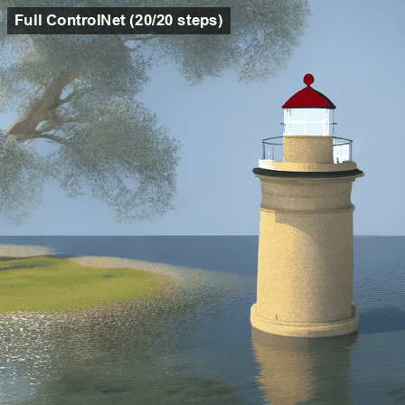
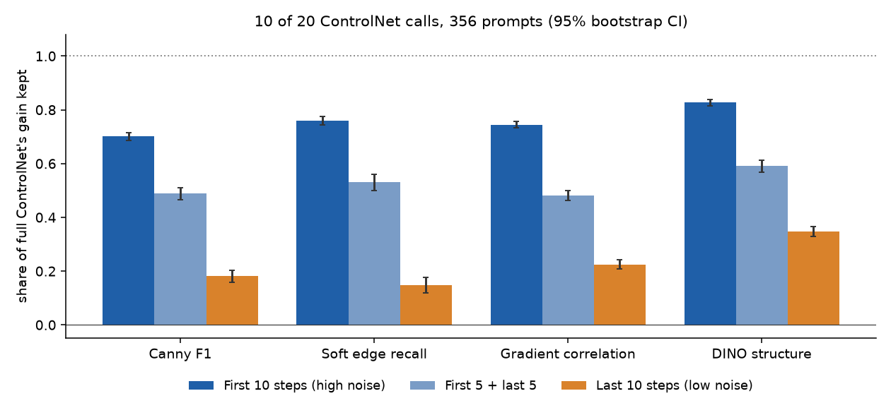
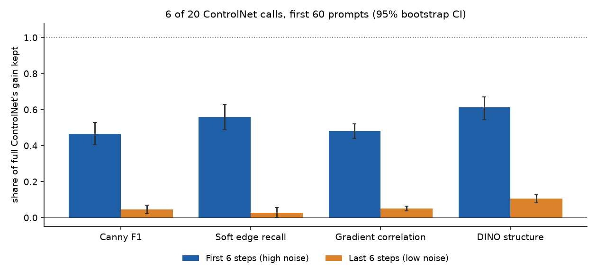
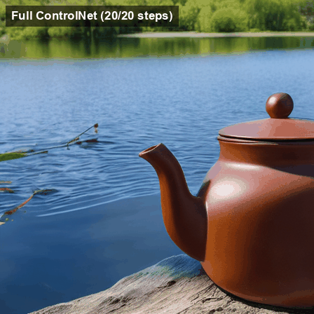
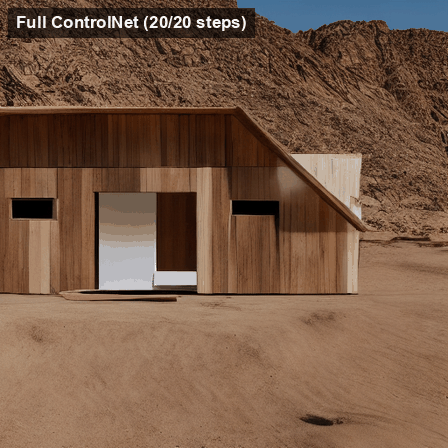
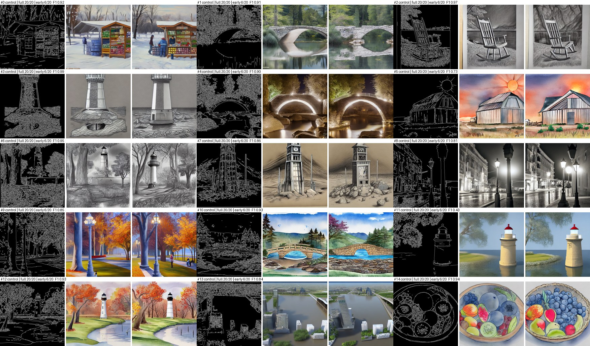

# Which denoising steps does ControlNet actually need?

ControlNet runs a second network next to the Stable Diffusion UNet on every denoising step. This
project runs it on only some of the steps, really skipping its forward pass on the rest, and measures
how much of the control signal survives.

**Short answer from our runs: the high-noise (early) steps carry most of the control. The low-noise
(late) steps carry very little.** With the same number of ControlNet calls, running it on the first
steps keeps far more of the control than running it on the last steps.



*Full ControlNet (20/20 steps) fading to ControlNet on the first 6 steps only. Same prompt, control
image and seed. The tower, horizon and island stay in place, while the tree and the fine details change.*

## Setup

- Stable Diffusion 1.5 (fp16) with the Canny ControlNet (`lllyasviel/sd-controlnet-canny`), 20 DDIM
  steps, 512x512, guidance 7.5. One RTX 4080 laptop GPU.
- For every prompt we generate a base image without control and take its Canny edges as the control
  image. Then we generate again with a different seed under each condition, so any structure that
  matches the control has to come from ControlNet.
- Conditions: ControlNet on all 20 steps (full), on none (no control), and on subsets of the steps:
  the first steps (high noise), the last steps (low noise), and the first 5 + last 5.
- Prompts come from a small template list (subject x scene x style), 1200 combinations. All conditions
  of one prompt share the prompt, control image and seed.
- **Control strength** is measured by re-extracting structure from the output and comparing it with
  the control, with four metrics. Canny F1 alone is a weak signal here: control maps are dense, so
  unrelated images already score about 0.45.
  - *Canny F1*: output edges vs control edges within 2 px.
  - *Soft edge recall*: how close each control edge is to the nearest output edge, with a smooth falloff.
  - *Gradient correlation*: threshold-free agreement of image gradients with the source image.
  - *DINO structure distance*: difference in DINO self-similarity layout from the source image (lower is better).
- We report the **share of full ControlNet's gain over no control** that each setting keeps (1 = as
  good as full, 0 = as bad as no control), with 95% bootstrap intervals over images.

## Result 1: 10 of 20 calls, 356 prompts



| setting (10 of 20 calls) | Canny F1 | soft edge recall | gradient corr. | DINO structure |
|---|---|---|---|---|
| first 10 steps (high noise) | 0.70 | 0.76 | 0.75 | 0.83 |
| first 5 + last 5 | 0.49 | 0.53 | 0.48 | 0.59 |
| last 10 steps (low noise) | 0.18 | 0.15 | 0.22 | 0.35 |

Raw Canny F1: no control 0.452, full 0.859, first 10 steps 0.738, first 5 + last 5 0.651, last 10 steps
0.526. The ordering full > high noise > combined > low noise holds on every metric, and the paired
differences between settings have confidence intervals that exclude zero. The last 10 steps do not
improve edge placement at all (Chamfer distance 13.9 px vs 13.6 px with no control).
Full tables: [`results/run2/summary.md`](results/run2/summary.md).

## Result 2: 6 of 20 calls, first 60 prompts

Same prompts and seeds as the first 60 of Result 1, with equal compute (6 calls each).



| setting | calls | Canny F1 | soft edge recall | gradient corr. | DINO structure |
|---|---|---|---|---|---|
| first 6 steps (high noise) | 6 | 0.47 | 0.56 | 0.48 | 0.61 |
| last 6 steps (low noise) | 6 | 0.04 | 0.03 | 0.05 | 0.11 |
| first 10 steps (for reference) | 10 | 0.72 | 0.79 | 0.74 | 0.84 |
| first 5 + last 5 (for reference) | 10 | 0.49 | 0.55 | 0.49 | 0.63 |

At equal compute, the first 6 steps beat the last 6 on every metric (Canny F1 0.611 vs 0.425, paired
difference 0.186, 95% CI 0.145 to 0.227). The last 6 steps are barely better than no control, and
their edge-placement distance is slightly worse than no control. The first 5 + last 5 setting is about
as good as the first 6 steps alone, so its late steps add little. Full tables:
[`results/run3_60prompts/summary.md`](results/run3_60prompts/summary.md).

## Examples

The examples below were picked to show the effect clearly, so they are the best cases, not typical ones.




Contact sheets for the first 60 prompts (control edges, full ControlNet, first 6 steps), unselected:
[sheet 1](results/samples60/sheet1.jpg), [2](results/samples60/sheet2.jpg),
[3](results/samples60/sheet3.jpg), [4](results/samples60/sheet4.jpg).



On the unselected sheets the 6-step version usually keeps the main layout (buildings, towers, bridges
in the right places) but drifts in the details, and it follows fine texture edges much less than full
ControlNet.

## Correctness check

The gated denoising loop with every step enabled gives the same image as the stock diffusers
`StableDiffusionControlNetPipeline` on identical latents (mean and max absolute difference 0.0 on the
three prompts checked, [`results/run2/verify.json`](results/run2/verify.json)). On skipped steps the
ControlNet forward pass is not called at all; a forward hook counts the real calls.

## Limitations

- One control type (Canny), one model (SD 1.5), one step count (20) and one scheduler (DDIM). Nothing
  here says the same holds for depth or pose control, SDXL or other samplers.
- Prompts are templates and the controls come from SD-generated images, not a real dataset. Control
  strength is measured by re-extracting edges, with no human judgement and no FID/LPIPS.
- "First steps" and "last steps" are the two ends of one monotone noise schedule, so these are not
  independent hypotheses beyond this scheduler. The first 6 and first 10 steps are also different
  amounts of compute, as noted in each table.
- Result 2 uses 60 prompts, so its intervals are wider than Result 1's.
- Runtime is not a result here. The measured times are noisy on a laptop GPU (wide spread across
  repeats, no clean relationship to the number of ControlNet calls), so we make no speedup claim.

## Code

```
src/sparsecn/
  timesteps.py, schedules.py   step bookkeeping and the gating policies
  settings.py                  the conditions used in the runs and their step masks
  diffusers_adapter.py         gated denoising loop on real Diffusers UNet + ControlNet
  sampler.py                   cost report type used by the loop
  runner.py                    SD 1.5 + ControlNet runner and the DINO structure metric
  edge_metrics.py, stats.py    the metrics and the bootstrap statistics
  prompts.py                   prompt pool
  experiment.py, report.py     run / rescore / rerun commands and the summary tables
tests/                         CPU tests (no weights, no network)
results/                       summaries, figures, sample images and GIFs
```

```
pip install -e ".[experiment]"
python -m sparsecn.experiment run --out runs/run1 --budget-min 120
python -m sparsecn.experiment summarize --out runs/run1
```

The experiment needs a CUDA GPU and downloads about 3.5 GB of weights from the Hugging Face Hub.
