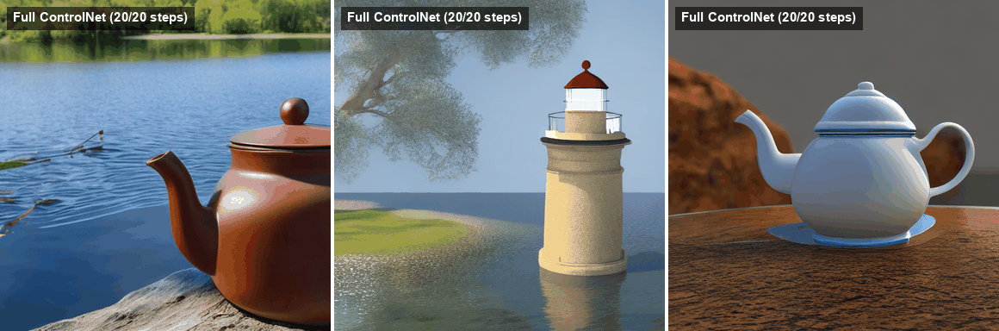

# Sparsifying ControlNet Calls for Efficient Structural Conditioning

<p align="center">  </p>

An optimization of the original ControlNet [1] paper that sparsifies ControlNet calls to optimize inference with structural conditioning. Typically, structural conditioning through ControlNet requires a second network to run in tandem with our original diffusion model on every denoising step to inject structural control signals into the main generator. In comparison, this project leverages the fact that structural properties of images generated by diffusion are typically defined during early denoising steps, and that their representations typically lie in lower-frequency noise bands [2], to only run ControlNet on the first 6 of 20 denoising steps in Stable Diffusion without a major quality loss in structural fidelity.

## Setup

- Stable Diffusion 1.5 [3] with the Canny ControlNet (`lllyasviel/sd-controlnet-canny`), 20 DDIM steps, 512×512 image size, guidance strength of 7.5.
- For every prompt, we generate a base image without control and take its Canny edges as the control image. Then we generate again with a different seed under two conditions: ControlNet on 20/20 DDIM steps and ControlNet on the first 6/20 DDIM steps.
- Text prompts come from a small template list, each describing the subject, scene, and style of the generated image. For a specific prompt, both conditions use the same seed and control image.
- Control strength is measured as Chamfer distance improvement retained: the share of full ControlNet's reduction in edge distance, relative to no control, that sparse conditioning keeps.
- We report the **share of full ControlNet's gain over no control** retained by sparsification (1 = as good as full ControlNet, 0 = as bad as no control).

## Results: Sparse ControlNet Conditioning

We evaluate 100 prompts with matched seeds and control images. We then compare conditioning schedules using the proportion of full ControlNet's structural improvement retained, as measured by Chamfer Distance.

| Setting                    | ControlNet Calls | Chamfer Distance Improvement|
| -------------------------- | ---------------: | --------------------------: |
| First 6 steps (high noise) |                6 |                     0.83    |
| Last 6 steps (low noise)   |                6 |                     -0.11   |

At equal compute, conditioning during the first 6 denoising steps retains substantially more structural fidelity than conditioning during the last 6 steps (0.83 vs. -0.11). These results suggest that structural conditioning is most effective during the early, high-noise stages of diffusion sampling, enabling a **70% reduction in ControlNet evaluations** while retaining approximately **83% of the structural improvement** achieved by full conditioning.

## Examples

The examples below were picked to show the effect clearly, so they are the best cases, not typical ones.


Contact sheets for the first 60 prompts (control edges, full ControlNet, first 6 steps), unselected:
[sheet 1](results/samples60/sheet1.jpg), [2](results/samples60/sheet2.jpg),
[3](results/samples60/sheet3.jpg), [4](results/samples60/sheet4.jpg).


On the unselected sheets the 6-step version usually keeps the main layout (buildings, towers, bridges
in the right places) but drifts in the details, and it follows fine texture edges much less than full
ControlNet.

## Code

```
src/sparsecn/
  timesteps.py, schedules.py   step bookkeeping and the gating policies
  settings.py                  the conditions used in the runs and their step masks
  diffusers_adapter.py         gated denoising loop on real Diffusers UNet + ControlNet
  sampler.py                   cost report type used by the loop
  runner.py                    SD 1.5 + ControlNet runner and the DINO structure metric
  edge_metrics.py, stats.py    the metrics and the bootstrap statistics
  prompts.py                   prompt pool
  experiment.py, report.py     run / rescore / rerun commands and the summary tables
tests/                         CPU tests (no weights, no network)
results/                       summaries, figures, sample images and GIFs
```

```
pip install -e ".[experiment]"
python -m sparsecn.experiment run --out runs/run1 --budget-min 120
python -m sparsecn.experiment summarize --out runs/run1
```

The experiment needs a CUDA GPU and downloads about 3.5 GB of weights from the Hugging Face Hub.
